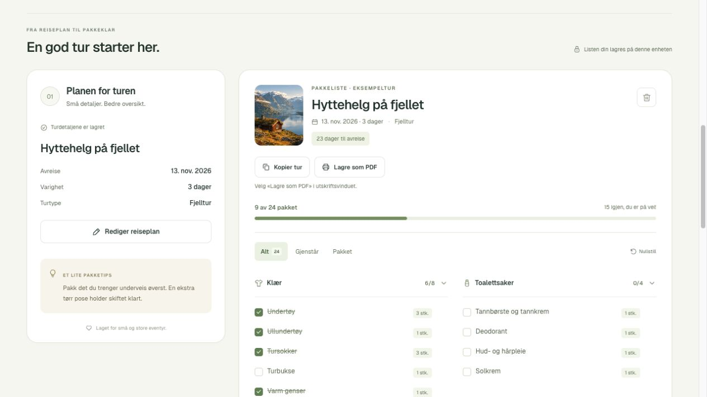
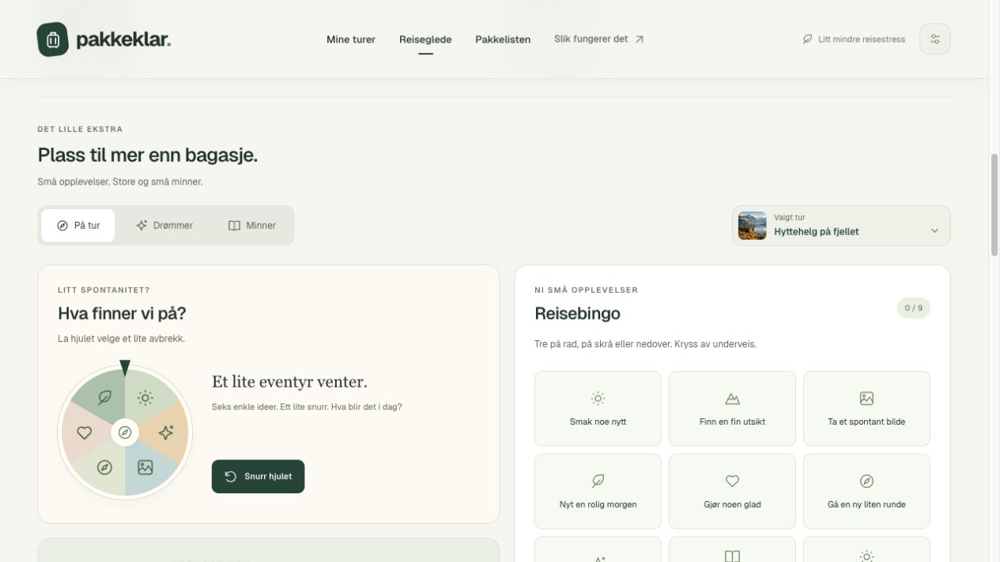
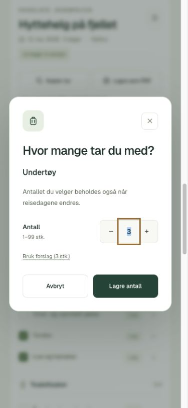
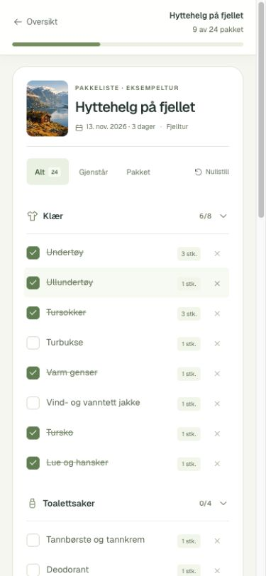
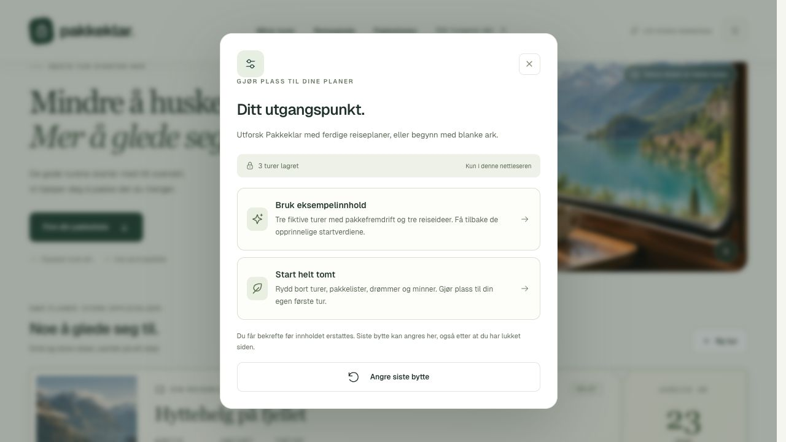
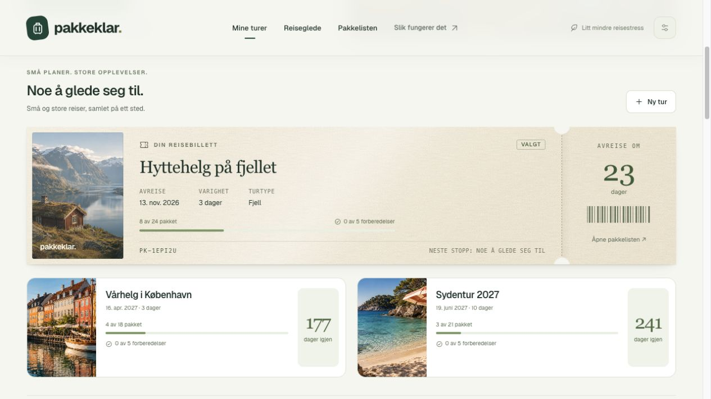

# Pakkeklar

**Mindre å huske. Mer å glede seg til.**

En nettapp for deg som vil ha oversikt før hytteturen, storbyhelgen eller strandferien. Pakkeklar samler reiseplanen, en personlig pakkeliste og de små forberedelsene før avreise på ett sted.


**[Åpne Pakkeklar](https://lassejolsen.github.io/pakkeklar/)** · [Kildekode](https://github.com/lassejolsen/pakkeklar) · [Tester og publisering](https://github.com/lassejolsen/pakkeklar/actions/workflows/pages.yml)

Publisert på GitHub Pages 21. oktober 2026. Ingen innlogging er nødvendig. Startinnholdet består av tre fiktive turer som kan tilpasses eller byttes ut via innstillingene.

## Problemet og løsningen

Pakkelister må ofte skrives på nytt, og det er lett å glemme både småting og forberedelser. Målgruppen er reisende som ønsker en enkel oversikt uten konto eller komplisert oppsett. Appen starter med konkrete forslag som kan tilpasses og brukes igjen på neste tur.

Tre deler utgjør hovedflyten:

1. **Planlegg turen.** Navn, valgfri avreisedato, turtype, varighet og eget valg av reisebilde. Lagrede detaljer samles i en kompakt oppsummering med «Rediger reiseplan». Turoversikten viser nedtelling, pakkefremdrift og forberedelser for opptil 12 turer.
2. **Gjør pakkelisten til din.** Velg storby, fjell eller strand, legg til egne ting, fjern unødvendige forslag og juster antall. Kopier listen til neste reise.
3. **Pakk og gjør deg klar.** Kryss av, filtrer på gjenstående eller pakket, lukk kategorier og bruk «Før avreise». Mobilens pakkemodus holder fremdriften synlig og gir listen plass. Fortsett senere fra samme nettleser, eller skriv ut en papirliste.



## Reiseglede før, under og etter turen

- **Reisebillett:** nærmeste daterte tur vises som en papirpreget billett med varm kremfarge, fin papirstruktur, trykt bildepreg, perforering og en egen avrivningsdel for nedtellingen. En svak skygge erstatter den ytre rammen. Overflaten har diagonal glans og et kort lyssveip ved musepeker eller tastaturfokus; redusert bevegelse slår av sveipet. Billetten viser avreise, varighet, pakkestatus og forberedelser. Referansen og strekkoden er dekorative. Turen vises bare her, mens øvrige turer ligger som kort under i datorekkefølge. Knappen åpner riktig pakkeliste. Reisefølge er ikke med.
- **Drømmeskuffen:** reiseideer uten dato med navn, notat, motiv og turtype. Tre merkede idéforslag gir et utgangspunkt. En idé kan bli en selvstendig tur; den opprinnelige drømmen beholdes med lenke til turen.
- **Aktivitetshjul:** seks enkle aktiviteter, med umiddelbar respons og et snurr som lander på riktig motiv. Samme forslag trekkes ikke to ganger på rad. Ved redusert bevegelse kommer resultatet med én gang.
- **Reisebingo:** 3 × 3 ruter per tur. Fullførte rader, kolonner og diagonaler markeres. Nullstilling kan angres.
- **Spilleliste:** egen tittel, omslag fra turbildet og en validert Spotify-spillelistelenke. Avspilling åpnes i Spotify; appen bruker ingen Spotify-konto, API-nøkkel eller innebygd spiller.
- **Reisepass:** illustrerte stempler fra gjennomførte turer. En planlagt tur kan stemples fra dagen etter siste turdag; tidligere turer kan legges til manuelt. Passet er en samlet reisehistorie, mens turvelgeren styrer resten av kortene.
- **Minneglass:** tekstlapper med dato, separat per tur. Trykk på en lapp i glasset eller i listen for å lese, redigere eller fjerne den. Fjerning kan angres.
- **Kofferten fylles:** en liten SVG-illustrasjon får farge og innhold i takt med faktisk pakkefremdrift. Den er skjult på papir.

Reiseglede er samlet i tre tastaturvennlige faner: På tur, Drømmer og Minner. Det holder dashboardet kompakt. Turvelgeren ligger sammen med fanene og viser et lite bilde av valgt tur; på mobil står den over fanene. Alle brukerfelt settes inn som tekst, og bilder kommer fra de eksisterende lokale motivene.



## Tilpasninger som blir med videre

- **Varighet fra 1–30 dager:** automatiske mengder tilpasses. Egne tillegg, fjernede forslag, manuelt valgte antall og forberedelser beholdes.
- **Antall fra 1–99:** trykk på mengden ved et punkt. «Bruk forslag» lar antallet følge varigheten igjen. Egne antall følger med i lagring, kopiering og PDF.
- **Når antallet øker:** et allerede pakket punkt blir gjenstående igjen, slik at det ekstra som trengs ikke glemmes. Uendret eller lavere antall beholder avkryssingen.
- **Bytte av turtype:** egne tillegg, felles punkter og felles forberedelser beholdes. Før lagring vises hvilke forslag som legges til og tas ut. Felles forslag som brukeren har fjernet, hentes ikke tilbake. Et plagg som endrer betydning, som sokker til tursokker, behandles som et nytt forslag.
- **Kopiering:** alle ting og antall følger med; kopien får egen identitet og tomme avkryssinger. Originalen beholdes.
- **Tryggere redigering:** «Ulagrede endringer» vises ved endrede turdetaljer. Før turbytte, kopiering, ny tur eller pakkemodus kan brukeren lagre, forkaste eller fortsette å redigere. Siste fjerning av et enkeltpunkt kan angres.
- **Bilde per tur:** velg blant sju eksisterende motiver, eller la bildet følge turtypen automatisk. Valget brukes på turkortet og ved pakkelistens overskrift, og følger med ved lagring og kopiering.

<details>
<summary>Se antallsdialogen på mobil</summary>



</details>

<details>
<summary>Se pakkemodus på mobil</summary>



</details>

## Designvalg

- **Rolig uttrykk:** lys bakgrunn, skogsgrønne hovedhandlinger og dempede kategorier gir innholdet plass. En serifoverskrift skaper reisestemning, mens Geist brukes i skjemaer og lister.
- **Bilder med en funksjon:** turtypene får gjenkjennelige motiver. Sju genererte reisebilder skifter automatisk hvert 15. sekund. Hvert motiv har en egen kort bildetekst og et passende ikon, med lys tekst på en gjennomsiktig glassflate. Bildeteksten toner ut og inn sammen med bildet. En langsom zoom på opptil 3,5 % gir motivet litt liv; pauseknappen stopper også zoomen. Manuelt bildevalg gir umiddelbar respons og starter en ny 15-sekundersperiode; bare pauseknappen stopper avspillingen. Ved redusert bevegelse skjer skiftene uten fade, zoom eller trykkeffekt.
- **Tydelig hierarki:** reiseinspirasjon først, deretter turene, reiseglede og den aktive pakkelisten. Toppmenyen følger med ved rulling, og menymarkeringen følger seksjonen. Oppsettet går fra to kolonner til én på mobil; pakkemodus skjuler bilder og planlegging øverst mens listen brukes.
- **Popuper med egen rulling:** bakgrunnen låses mens en dialog er åpen. Informasjonsvinduet får større bredde på PC, og lange dialoger kan rulles innenfor mobilskjermen.
- **En tydelig avslutning:** «Alt er pakket» viser videre til eventuelle forberedelser som gjenstår. Først når begge sjekklistene er ferdige, vises «Klar for avreise».
- **Digitalt og papir har ulike behov:** skjermen viser fremdrift; PDF-en har tomme bokser for penn, uten tellere, nedtelling, ferdigmerker eller overstrykninger. Hele listen blir med uansett skjermfilter og lukkede kategorier, og appens avkryssinger beholdes.
- **Personlige detaljer:** billett, hjul, reisepass, minneglass og koffert er laget med lokal CSS/SVG. Funksjonene trenger ingen nye tredjepartsbiblioteker.
- **Enkel teknisk løsning:** HTML, CSS og JavaScript uten rammeverk, backend eller API-nøkler. Bilder og skrifter ligger i prosjektet, så demoen er uavhengig av eksterne tjenester.

## Bygget og forbedret med AI

Utvikleren valgte idé, omfang og visuelt uttrykk, vurderte prototypen og ga tilbakemeldinger underveis. ChatGPT/Codex hjalp med planlegging, kode, bildegenerering, automatiske tester og nettleserkontroll.

| Konkret tilbakemelding / funn | Forbedring |
| --- | --- |
| En dekorativ boks over bildet virket feilplassert | Boksen ble fjernet; bildet fikk mer ro |
| Dashboardet trengte innhold som viste bruken | Tre fiktive turer med nedtelling og ulik pakkefremdrift; forklaringen ligger i innstillingene |
| Eksempelmerker tok unødig plass på kortene | Renere kort og egne innstillinger for eksempelinnhold, tom start og angre |
| PDF skal brukes til avkryssing med penn | Eget papiroppsett med tomme bokser og uten digitale tellere |
| Endret varighet erstattet en tilpasset liste | Egne ting, fjerninger og manuelle mengder beholdes |
| Økt antall kunne gjøre en ferdig avkryssing misvisende | Bare punkter som trenger flere ting blir gjenstående igjen |
| Mobilbrukeren måtte rulle forbi planlegging mens hen pakket | Egen pakkemodus med fast fremdriftslinje |
| Ulagrede turdetaljer kunne forsvinne ved turbytte | Synlig lagringsstatus og valg om å lagre, forkaste eller fortsette |
| Ny turtype erstattet egne tilpasninger | Egne og felles punkter beholdes, med forhåndsvisning av endringene |

Se [arbeidsloggen](docs/ARBEIDSLOGG.md) for prosessen og [testloggen](docs/TESTLOGG.md) for faktisk gjennomførte kontroller. Agentens kontroller er skilt fra brukerens egne vurderinger.

## Kjør lokalt

Krever **Node.js 20 eller nyere**. Ingen pakker må installeres.

```sh
npm start
```

Åpne [lokal forhåndsvisning](http://127.0.0.1:4177/). Er porten opptatt, bruk `PORT=4178 npm start`. Bruk HTTP-server fremfor å dobbeltklikke på HTML-filen, siden JavaScript-filene bruker moduler.

## Test og kontroll

```sh
npm test
npm run check
```

**54 automatiske tester** dekker blant annet pakkeforslag, varighet, antall, bytte av turtype, bildevalg, endrede turdetaljer, lokale lagringsformater, kopiering, forberedelser, datoer og sommer-/vintertid. Ti av testene dekker reiseglede-data, bingorekker, hjultrekk, neste reisebillett, passdatoer, konvertering av drømmer og validering av Spotify-lenker. Sju tester dekker tom start, gjenoppretting av eksempler, angre etter omlasting og tilbakeføring ved lagringsfeil. Nettleserkontroll omfatter lagring etter omlasting, egne tillegg, filtre, kopiering, lagre-/forkastflyten, sammenleggbare kategorier, ferdigvisning, mobilbredder på 390 og 320 piksler og PDF-eksport. Eksporten ble kontrollert både som tekst og rendret A4-side, med «Pakket» aktivt og kategorien Klær lukket: alle 23 punkter i den lokale prøveturen og alle 19 punkter i den offentlige prøveturen kom med, sammen med fem forberedelser og tomme avkryssingsbokser.

To tester kontrollerer også at oppgraderingen til tre eksempelturer bevarer eksisterende innhold, respekterer turgrensen og ikke gjenoppretter fjernede eksempler.

Det er ikke gjennomført full testing på flere nettlesere eller fysisk skriver. PDF-kontrollen bruker nettleserens utskriftsmotor. En vanlig liste passer på én A4-side; lengre lister kan bruke flere.

## Data og avgrensninger

Turene lagres i `localStorage` på samme adresse, enhet og nettleser. Ingen innlogging, database, analyseverktøy eller eksterne API-er brukes; appen sender ikke innholdet i turene til en server. En Spotify-lenke åpner en ekstern tjeneste først når brukeren trykker på den. Private spillelistelenker legges inn lokalt; de er ikke inkludert i kildekoden. Data synkroniseres ikke mellom enheter og kan forsvinne hvis nettleserdata slettes eller privat nettlesing avsluttes.

Første åpning viser tre **fiktive eksempelturer**: Hyttehelg på fjellet, 13. november 2026 (8/24 pakket), Vårhelg i København, 16. april 2027 (4/18 pakket), og Sydentur 2027, 19. juni 2027 (3/21 pakket). Et eldre turarkiv med begge de opprinnelige eksemplene får København lagt til én gang dersom det er plass. Endrede turer og valgt tur beholdes. Slettes det nye eksemplet senere, kommer det ikke tilbake ved omlasting. Skjermbildene viser en lokalt brukt eksempelvisning og kan derfor ha annen fremdrift. Eldre lagrede lister oppgraderes uten å miste egne punkter eller avkryssinger.

Ved førstegangsbesøk vises disse startverdiene og tre idéforslag i drømmeskuffen. Minner, reisepass, bingo og spillelistekoblinger starter tomme. Ved senere besøk i samme nettleser beholdes egne endringer. Lokale kontroller og kontrollen av den offentlige adressen dokumenteres separat i testloggen.

**Innstillinger i toppmenyen** gir to valg: «Bruk eksempelinnhold» henter tilbake de opprinnelige startverdiene, mens «Start helt tomt» gir en tom app med et skjema for første tur. Begge erstatter dagens turer og reiseglede etter bekreftelse. Ulagrede turdetaljer kan lagres først. Siste bytte lagres som én lokal sikkerhetskopi, og kan angres også etter omlasting. Et nytt bytte erstatter forrige sikkerhetskopi; bruk av Angre erstatter eventuelle endringer gjort etter byttet. Eksempelturene har ingen egne merker på kortene; innstillingene forklarer at startinnholdet er fiktivt.

<details>
<summary>Se innstillingene</summary>



</details>



Listene er forslag og må tilpasses vær, reisemål og egne behov. Appen støtter opptil 200 punkter per liste. «Før avreise» har fem faste forslag per turtype. Åpne/lukkede kategorier huskes per tur mens siden er åpen; etter omlasting åpnes de igjen. Pakkemodus vises på mobilbredder opptil 760 piksler.

Reiseglede lagres separat under `pakkeklar.reiseglede.v1`, slik at de eksisterende pakkelistene ikke trenger en ny datamigrering. Drømmeskuffen har plass til 20 ideer, reisepasset 60 stempler og hvert minneglass 30 lapper på opptil 600 tegn. Kopierte turer får egne, tomme opplevelser. Ved sletting av en tur forklarer bekreftelsen at bingo, spillelistekobling og minneglass også slettes; pass-stemplene beholdes.

## Prosjektstruktur

| Fil / mappe | Ansvar |
| --- | --- |
| `index.html` | Innhold, skjemaer og dialoger |
| `styles.css` | Design, mobilvisning og utskrift |
| `packing.js` | Rene funksjoner for turer, mengder, datoer og validering |
| `app.js` | Visning, brukerhandlinger og lokal lagring |
| `dashboard.js` / `dashboard.css` | Reisebillett, drømmer, opplevelser, minner og koffertillustrasjon |
| `adventure-data.js` | Lagringsformat, validering, bingo, hjulvalg og reisedatoer for dashboardet |
| `settings-data.js` | Bytte av startinnhold, lokal sikkerhetskopi, angre og tilbakeføring ved lagringsfeil |
| `carousel.js` | Bildeskift, kontroller og pausing |
| `trip-images.js` | De sju bildemotivene og automatisk bilde per turtype |
| `assets/` | Komprimerte reisebilder, ikon, skrifttype og fontlisens |
| `scripts/serve.mjs` | Lokal server på loopback-adressen |
| `scripts/build.mjs` | Lager `_site/` fra en avgrenset liste med appfiler og lokale ressurser |
| `.github/workflows/pages.yml` | Syntakskontroll, tester, bygg og publisering på GitHub Pages |
| `tests/` | Tester med Nodes innebygde testverktøy |
| `docs/` | Arbeidslogg, testlogg, skjermbilder, bruksveiledning og utviklingsplan |

## Demonstrasjon og publisering

[Kom i gang med Pakkeklar](docs/DEMO_OG_BESKRIVELSE.md) · [Utviklingsplan](docs/FORBEDRINGSFORSLAG.md)

`npm run build` lager `_site/` med de ti appfilene og innholdet i `assets/`. Stiene er relative og fungerer under `/pakkeklar/` på GitHub Pages. Dokumentasjon, lokale testutdata og bildeoriginaler tas ikke med i selve nettstedet.

GitHub Actions kjører syntakskontroll, alle tester og bygg. Endringer på `main` publiseres først når kontrollene består; pull requests testes uten å publiseres. Oppsettet følger [GitHubs dokumentasjon for egne Pages-workflows](https://docs.github.com/en/pages/getting-started-with-github-pages/using-custom-workflows-with-github-pages).

## Bilder og skrifttype

Reisebildene er generert med Codex sin innebygde imagegen-funksjon. De er illustrasjoner, ikke dokumentasjon av faktiske reisemål. Prompter er bevart i [bildeprompter](docs/BILDEPROMPTER.md) og [bildefremvisning](docs/BILDER_BILDEFREMVISNING.md). Nettsiden bruker komprimerte JPEG-filer; originalene er bevart lokalt i Git-ignorert `design/originals/`.

Geist brukes under [SIL Open Font License](assets/FONT-LICENSE.txt). Ikonene er enkle SVG-former i prosjektet. Papirstrukturen er en egen, liten SVG-tekstur laget med filterstøy, uten eksterne bildeavhengigheter. Ingen bilder eller skrifter lastes fra eksterne nettsteder under bruk.
